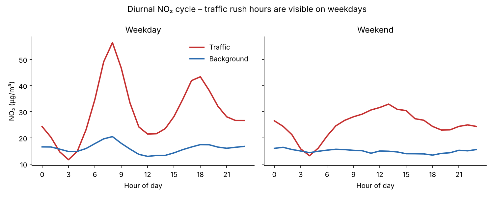
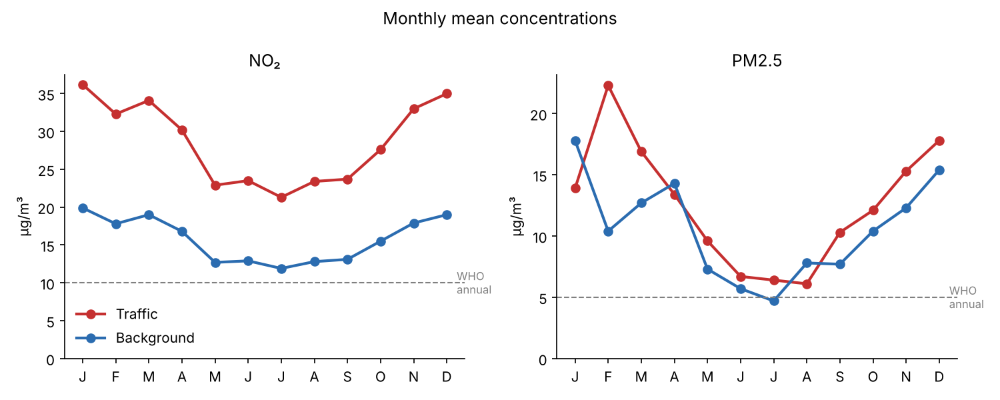
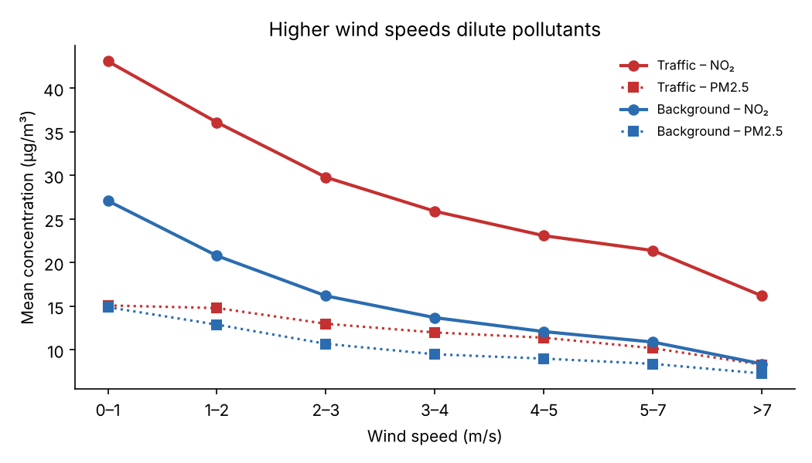

# Urban Air Quality Analysis: NO₂ & PM2.5

Analysis of hourly nitrogen dioxide (NO₂) and fine particulate matter (PM2.5)
concentrations at two urban monitoring stations – one **traffic** site and one
**urban background** site – for 2023–2024, including meteorological drivers and a
comparison against the **WHO Air Quality Guidelines (2021)**.



## Questions

1. How do NO₂ and PM2.5 differ between a traffic and a background site?
2. What daily and seasonal patterns do the pollutants follow?
3. How often are the WHO guideline values exceeded?
4. How do wind speed and temperature influence concentrations?

## Key results

| Station | NO₂ annual mean | Days NO₂ > 25 µg/m³ | PM2.5 annual mean | Days PM2.5 > 15 µg/m³ |
|---|---|---|---|---|
| Traffic 2023 | 28.5 µg/m³ | 205 | 11.6 µg/m³ | 85 |
| Traffic 2024 | 28.7 µg/m³ | 215 | 13.4 µg/m³ | 121 |
| Background 2023 | 15.7 µg/m³ | 21 | 10.1 µg/m³ | 61 |
| Background 2024 | 15.8 µg/m³ | 26 | 11.0 µg/m³ | 76 |

- **NO₂ is a traffic pollutant:** concentrations at the traffic site are almost
  twice as high, with distinct morning and evening rush-hour peaks on weekdays
  that disappear on weekends.
- **PM2.5 is a regional pollutant:** the difference between sites is small, and
  concentrations peak in winter (heating, stable atmospheric conditions).
- **Both stations exceed the WHO annual guidelines** (NO₂: 10 µg/m³,
  PM2.5: 5 µg/m³) in both years.
- **Wind dilutes pollution:** NO₂ drops by more than 60 % from calm conditions
  to wind speeds above 7 m/s (Spearman ρ = −0.39 to −0.60).

| Seasonal cycle | Wind effect |
|---|---|
|  |  |

## Methods

- Gaps of up to 3 hours are linearly interpolated per station.
- Daily means are only counted as valid if ≥ 18 of 24 hours are available (75 % rule).
- Exceedance days are counted against the WHO 2021 24-hour guideline values
  (NO₂: 25 µg/m³, PM2.5: 15 µg/m³).
- Relationships with meteorology are assessed with Spearman rank correlation
  and by binning hourly values into wind speed classes.

## Repository structure

```
├── data/
│   ├── raw/air_quality_hourly.csv     # hourly input data, both stations
│   └── processed/                     # monthly means, wind classes, WHO exceedances
├── figures/                           # generated plots
├── scripts/
│   └── analysis.py                    # cleaning, statistics, figures
├── requirements.txt
└── README.md
```

## Data

`data/raw/air_quality_hourly.csv` – one row per hour and station:

| Column | Description |
|---|---|
| `datetime` | Timestamp (YYYY-MM-DD HH:MM, local time) |
| `station` | `STATION_TRAFFIC` or `STATION_BACKGROUND` |
| `no2_ugm3` | Hourly mean NO₂ concentration (µg/m³) |
| `pm25_ugm3` | Hourly mean PM2.5 concentration (µg/m³) |
| `temp_c` | Air temperature (°C) |
| `wind_ms` | Wind speed (m/s) |

## Usage

```bash
pip install -r requirements.txt
python scripts/analysis.py
```

## License

MIT
